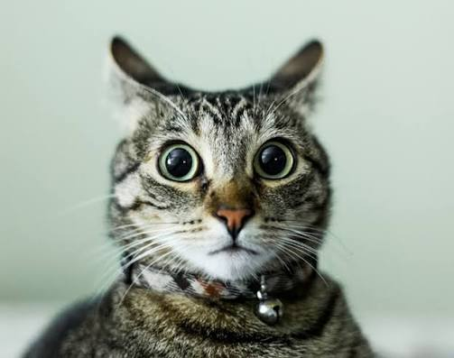
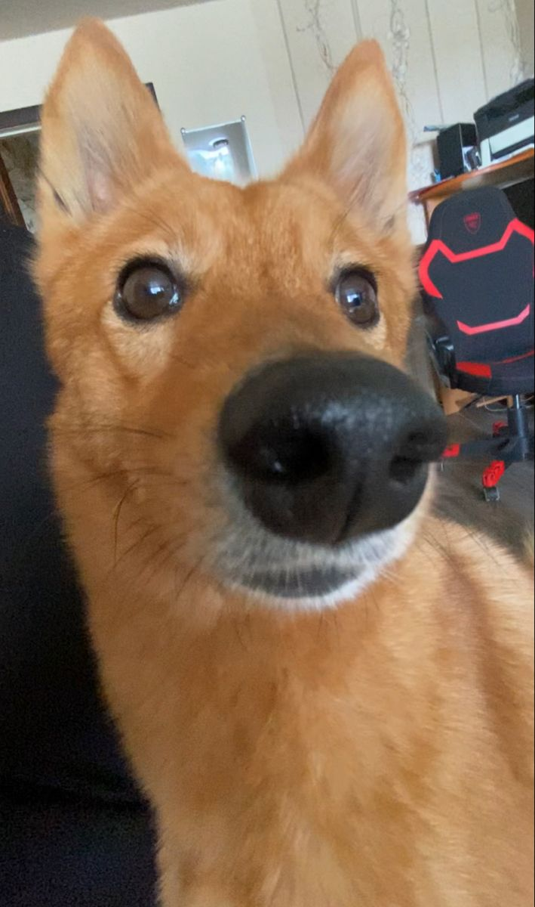

# 1.05.1 Разбор: Галерея

Задание: 1.05.1 Задание — Галерея · Теория: 1.05 Конспект — Картинки

**Балл: 7 / 10.** Почти все пункты условия выполнены. Главная ошибка — перекрещенные теги вокруг первой картинки.

## Что сделано верно ✅
- **Каркас правильный, `lang="ru"`** на месте, больше не `en`.
- **Картинки в папке `img`, пути верные:** `img/КОТ.jpg`, `img/СОБАКА.jpg`.
- **`alt` точно описывают картинки.** Я посмотрел обе: кот с большими глазами и рыжий пёс.
- **Пустой `alt=""` у декоративной картинки.**
- **`figure` у собаки идеальный:** `img` и `figcaption` внутри, всё закрыто.
- **`iframe` с YouTube работает**, у него есть `title`.
- **Все источники открываются в новой вкладке.**
- **В пропусках `img` наконец объяснён верно:** пустой элемент без содержимого. Это была твоя ошибка в трёх прошлых работах.

## Ошибки ⚠️

### В коде
1. **Перекрещивание вокруг первой картинки:**
   ```html
   <a href="img/КОТ.jpg">
     <figure>
       
   </a>                                  <!-- ❌ закрыл a раньше figure -->
   <figcaption>Удивлённый котик</figcaption>
   </figure>
   </a>                                  <!-- ❌ лишний: a уже закрыт -->
   ```
   Правило матрёшки: что открыл последним, закрываешь первым. Сейчас коробка `a` открыта раньше `figure`, а закрыта внутри неё. Тебе нужно, чтобы ссылкой была только картинка, поэтому `a` кладём вокруг `img`:
   ```html
   <figure>
     <a href="img/КОТ.jpg"></a>
     <figcaption>Удивлённый котик</figcaption>
   </figure>
   ```
2. **Пробелы в начале `<h2> Видео:</h2>`.** Та же привычка, что и раньше.
3. **`title="YouTube video player"`.** Это текст по умолчанию из кода YouTube, он ничего не сообщает о ролике. Заполни его своим описанием: что это за песня.

> 💡 Не ошибка, в условии этого не было: при 350×350 картинки вышли искажёнными, потому что настоящие размеры другие (кот 503×397, собака 709×1200). Как посчитать размеры без искажения, теперь есть в конспекте.

> 💡 Не ошибка, а на будущее: называй файлы латиницей и маленькими буквами, например `cat.jpg`. На GitHub Pages регистр важен, и `КОТ.jpg` и `кот.jpg` будут разными файлами, а кириллица в адресах превращается в длинный код. Ещё на странице нет `h1`: в условии я его не просил, но у страницы должен быть главный заголовок.

### В пропусках
4. **`alt=""`** (пропуски пустые): пустой `alt` сообщает, что картинка **декоративная и её можно пропустить**. Если `alt` нет совсем, программа для незрячих может зачитать вслух имя файла.
5. **«`width` и `height`, чтобы был виден размер картинки»** ❌. Браузер и так покажет картинку. Они нужны, чтобы браузер **заранее оставил место**, и текст не прыгал, пока картинка грузится.
6. **«`alt`, чтобы было видно её название»** — наполовину. Показывается не название, а **описание**. И `alt` нужен не только при ошибке загрузки: его читают программы для незрячих и поисковики. Вторая половина («описываю то, что изображено») верная.
7. **«Могут забанить»** — идея верная: чужая картинка не под твоим контролем. Причин больше: сайт могут удалить, переименовать файл или запретить показ на других сайтах.

## Исправленный код
Текст твой, правки только в разметке:

```html
<!DOCTYPE html>
<html lang="ru">
  <head>
    <meta charset="UTF-8">
    <title>Моя галерея</title>
  </head>

  <body>
    <h1>Моя галерея</h1>

    <figure>
      <a href="img/КОТ.jpg"></a>
      <figcaption>Удивлённый котик</figcaption>
    </figure>

    <figure>
      
      <figcaption>Собака с носом</figcaption>
    </figure>

    

    <h2>Видео:</h2>
    <iframe width="560" height="315" src="https://www.youtube.com/embed/lLxAbevUyIQ?si=EBG5sB0t6MlTMyRc"
      title="Песня с YouTube" allowfullscreen></iframe>

    <h2>Источники:</h2>
    <ul>
      <li><a href="https://lifeglobe.net/entry/5994" target="_blank">Кот удивлённый</a></li>
      <li><a href="https://ananasposter.ru/cat-space-5" target="_blank">Кот в очках в космосе</a></li>
      <li><a href="https://es.pinterest.com/pin/907827237388178270/" target="_blank">Рыжая собака с носом</a></li>
      <li><a href="https://www.youtube.com/watch?v=lLxAbevUyIQ&list=RDlLxAbevUyIQ&start_radio=1" target="_blank">Песня с YouTube</a></li>
    </ul>
  </body>
</html>
```

## Балл: 7 / 10
- **Код: 7 из 10.** Всё работает и условие выполнено, но теги перекрещены. Это основное правило вложенности, поэтому снижение заметное.
- **Пропуски: 7 из 10.** Пустые элементы и путь верные, но непонятно, зачем нужны размеры и пустой `alt`.
- Страницу в браузере не открывал, проверял по коду. Текст страницы и отсутствие комментариев на балл не влияют.

## Связанные заметки
- Задание: 1.05.1 Задание — Галерея
- Теория: 1.05 Конспект — Картинки
- Следующее: 1.06.1 Задание — Страница кофейни
- Курс: Веб — прогресс
